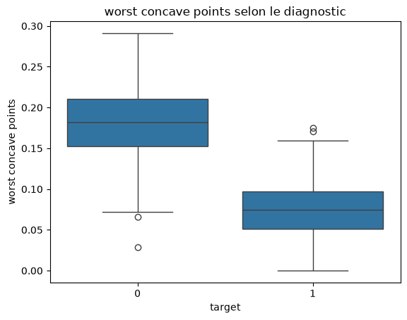
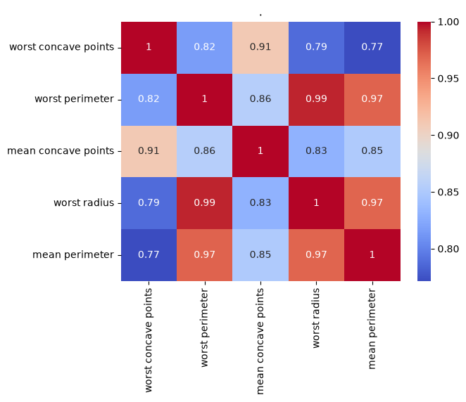
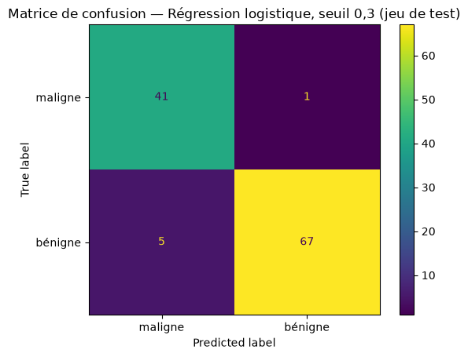

# 🩺 Classification de tumeurs du sein

> Modèle de Machine Learning qui classe une tumeur du sein comme maligne ou bénigne. Optimisé pour **ne pas rater de cancers** : il en détecte **41 sur 42 (rappel de 97,6 %)** sur des données jamais vues.

## Objectif
Prédire si une tumeur est **maligne** ou **bénigne** à partir de mesures réalisées sur des images de cellules.
Problème de **classification supervisée binaire**, avec une contrainte métier : un cancer non détecté est bien plus grave qu'une fausse alerte.

## Données
- Source : *Breast Cancer Wisconsin* (intégré à scikit-learn)
- 569 tumeurs : 357 bénignes (62,7 %) et 212 malignes (37,3 %), donc des **classes déséquilibrées**
- 30 variables : 10 caractéristiques des cellules (rayon, texture, périmètre, concavité…), chacune en moyenne, écart-type et valeur extrême

## Démarche
- **Nettoyage** : aucune valeur manquante, aucun doublon
- **Analyse exploratoire** : corrélations avec la cible, boxplots, redondance entre variables
- **Préparation** : split train/test 80/20 **stratifié**
- **Comparaison de 4 modèles** en validation croisée (5 folds), sur l'accuracy **et le rappel des tumeurs malignes**
- **Ajustement du seuil de décision** pour limiter les cancers non détectés
- **Évaluation finale** sur le jeu de test

## Analyse exploratoire

Les variables liées à la **taille** et à l'**irrégularité du contour** des cellules sont les plus discriminantes : les tumeurs malignes présentent des valeurs nettement plus élevées.



Plusieurs variables sont fortement redondantes (périmètre, rayon : corrélations de 0,97 à 0,99).



## Résultats

### Comparaison des modèles (validation croisée)

| Modèle | Accuracy | Rappel (malignes) |
|---|---|---|
| **Régression logistique** | **97,8 %** | **96,5 %** |
| SVM | 96,9 % | 95,3 % |
| KNN | 96,3 % | 92,9 % |
| Arbre de décision | 91,6 % | 92,4 % |

### Ajustement du seuil de décision

| Seuil | Rappel (malignes) | Précision (malignes) |
|---|---|---|
| 0,5 (défaut) | 96,5 % | 97,6 % |
| 0,4 | 97,6 % | 96,0 % |
| **0,3 (retenu)** | **98,2 %** | **94,4 %** |
| 0,2 | 98,2 % | 92,3 % |

Abaisser le seuil à 0,3 divise par deux les cancers non détectés, au prix de quelques fausses alertes.

### Évaluation finale (jeu de test, 114 tumeurs)

- **41 cancers détectés sur 42 (rappel de 97,6 %)**
- 5 fausses alertes (précision de 89 %)
- Accuracy globale : 94,7 %



## Ce que j'ai appris
- Choisir une métrique adaptée au contexte métier : avec des classes déséquilibrées et des erreurs de gravité différente, l'accuracy ne suffit pas
- Mesurer le rappel d'une classe précise avec un scorer personnalisé (`pos_label`)
- Comparer des modèles sur plusieurs métriques avec `cross_validate`
- Ajuster le seuil de décision à partir des probabilités, sans toucher au jeu de test
- Lire le compromis entre rappel et précision

## Lancer le projet
```bash
git clone https://github.com/yassinehq/Breast-cancer-ml.git
cd Breast-cancer-ml
python -m venv .venv
.venv\Scripts\activate
pip install -r requirements.txt
jupyter notebook notebooks/01_breast_cancer_classification.ipynb
```

## Stack
Python · pandas · NumPy · matplotlib · seaborn · scikit-learn · Jupyter